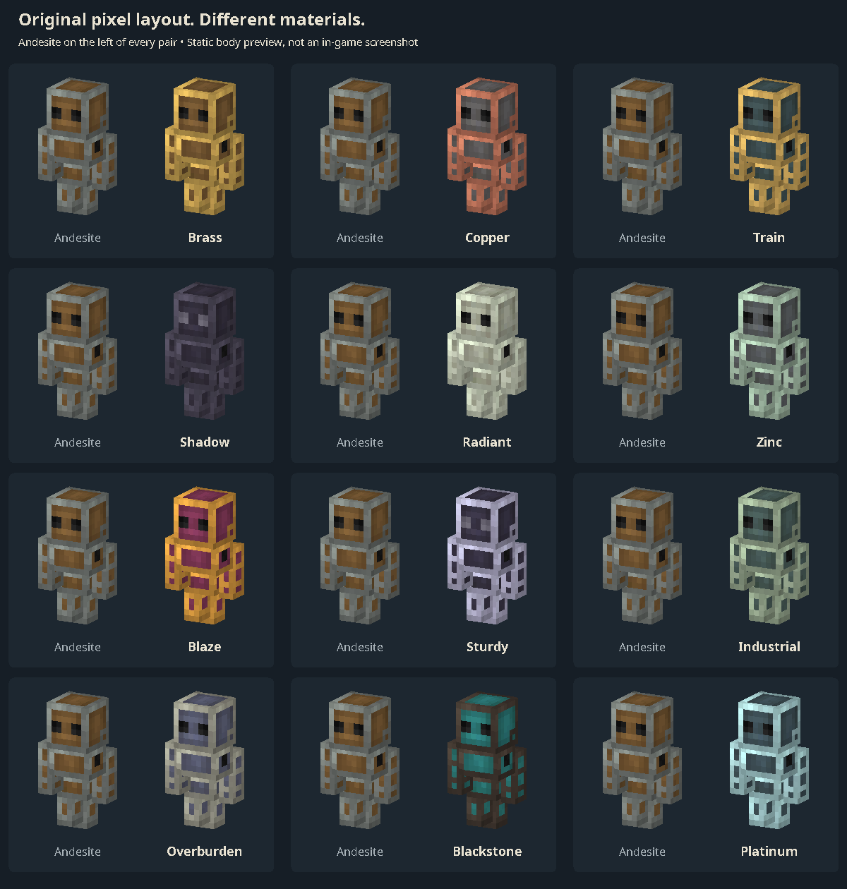

# Create: More Conductors

Casing appearances recoloured from the original conductor texture for Steam 'n' Rails conductors. Apply an existing conductor's cap to a supported casing to create a conductor made from that material.

**Development alpha — not a public release.** Install on both the server and every client. Test on a separate instance or a copy of your world first.



This is a static UV/model preview. In game, Steam 'n' Rails supplies the hats, model, animations and behaviour. Original Andesite conductors retain their original appearance.

## Supported environment

| Component | First alpha target |
| --- | --- |
| Minecraft | 1.21.1 |
| Java | 21 |
| NeoForge | 21.1.262 |
| Create | 6.0.10 |
| Steam 'n' Rails community port | 0.3.0-beta.2+neoforge-mc1.21.1 |

The alpha intentionally restricts its Create and Railways versions. Other versions have not been checked. Original upstream Steam 'n' Rails builds for other Minecraft versions are not substitutes.

## First lineup

| Appearance | Casing registry ID | Provider |
| --- | --- | --- |
| Andesite (original) | `create:andesite_casing` | Create |
| Brass | `create:brass_casing` | Create |
| Copper | `create:copper_casing` | Create |
| Train | `create:railway_casing` | Create |
| Shadow | `create:shadow_steel_casing` | Create |
| Radiant | `create:refined_radiance_casing` | Create |
| Zinc | `createcasing:zinc_casing` | Create Encased |
| Blaze | `blazinghot:blaze_casing` | Blazing Hot |
| Sturdy | `blazinghot:sturdy_casing` | Blazing Hot |
| Industrial | `dndesires:industrial_casing` | Dreams n' Desires |
| Overburden | `dndesires:overburden_casing` | Dreams n' Desires |
| Blackstone | `createthrusters:blackstone_casing` | Gadgets & Gizmos |
| Platinum | `createpropulsion:platinum_casing` | Create Propulsion Simulated |

Optional providers are not required. Each integration only responds to its listed registered block. The mod does not add casing recipes; Shadow and Radiant may require your existing recipe datapack. This first version has a fixed, designed lineup rather than automatic support for every casing.

## Behaviour

- Survival creation consumes one casing and one cap. Creative creation consumes the placed casing but retains the cap, matching the upstream interaction.
- The body material and cap colour are independent. Existing conductor jobs and interactions remain supplied by Steam 'n' Rails.
- Casing identity is saved on the existing conductor entity and included in NeoForge's additional spawn data when a player starts tracking it.
- Old conductors, missing variant data and unknown variant IDs fall back to Andesite.
- Named special skins retain priority over casing appearances.
- Healing materials and drops remain upstream behaviour. A different body does **not** provide material refunds, extra abilities, glow, or flight.

## Installation and player checks

Put the runtime `create-more-conductors-0.1.0-alpha.2.jar` in the test server's and every test client's `mods` folder, alongside the versions above. Restart both. The `-sources.jar` is for development and is not installed in the game.

No new world or new chunks are required. Follow [the alpha-2 test checklist](docs/TESTING.md). Do not deploy to the live SMP until the in-game checks are approved.

## Building

With a Java 21 JDK installed, run from this repository:

```sh
./gradlew build
./gradlew runGameTestServer
./gradlew runGameTestServer -PwithCasingTestMods
```

On Windows use `gradlew.bat` instead of `./gradlew`. Runtime and source JARs appear in `build/libs/`. GameTests are a separate development mod and are never packaged in the runtime JAR. A successful `build` alone does not mean the GameTests have run. The third command adds Encased, Blazing Hot and Dreams n' Desires to the test run only.

To rebuild artwork deterministically from the original atlas:

```sh
java tools/BakeTextures.java
java tools/PreviewConductors.java
```

See [art provenance](art/README.md) and [third-party notices](THIRD_PARTY_NOTICES.md). Original addon code uses MIT; upstream-derived skins and previews use LGPL-3.0. Installed dependencies retain their own licenses.
